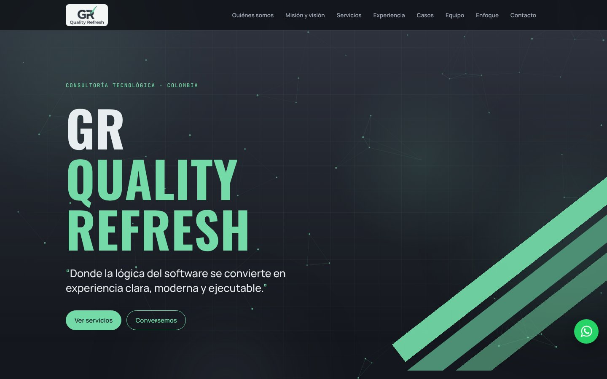
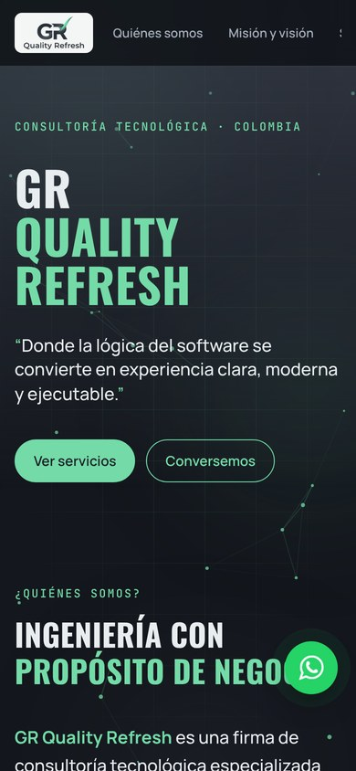
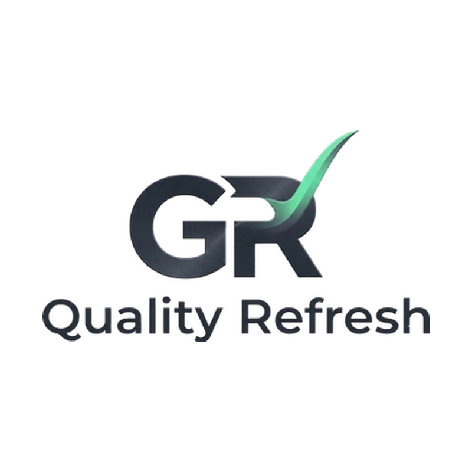

<p align="center">
  
</p>

# GR Quality Refresh · Brochure web

Brochure interactivo de **GR Quality Refresh**, firma de consultoría tecnológica especializada en diseño, desarrollo, automatización y modernización de soluciones digitales.

🔗 **Sitio en vivo:** https://grqualityrefresh.netlify.app

<p align="center">
  
  &nbsp;
  
</p>

## Qué incluye

- **Página de una sola vista** con menú fijo, barra de progreso y navegación por secciones: quiénes somos, misión y visión, servicios, capacidades, experiencia, casos de éxito, equipo, enfoque y contacto.
- **Fondo interactivo** en canvas: red de nodos que reacciona al cursor, auroras de luz y cuadrícula técnica. Se pausa cuando la pestaña no está visible y se queda quieto si el usuario activó "reducir movimiento".
- **Explorador de servicios**: al tocar un servicio se muestra lo que incluye; las áreas del equipo enlazan con su servicio.
- **Contacto por WhatsApp**: botón en la sección de contacto y botón flotante con mensaje predeterminado.
- **Formulario de contacto** que envía cada solicitud por correo con [Resend](https://resend.com), a través de una función de servidor en Netlify.
- Diseño adaptable a celular, accesible con teclado y sin dependencias externas en el navegador.

## Identidad visual

<p align="center">
  
</p>

| Color | Uso | Hex |
|---|---|---|
| Verde menta | Color principal de la marca, acentos y botones | `#74DBA8` |
| Verde profundo | Franjas y estados secundarios | `#4C8F74` |
| Pizarra | Degradados y superficies | `#434957` |
| Tinta | Fondo principal | `#14171D` |

Tipografías: **Oswald** (títulos), **Manrope** (textos) y **JetBrains Mono** (etiquetas).

## Equipo

<table>
  <tr>
    <td align="center" width="50%">
      <br>
      <strong>German Rodriguez</strong><br>
      CEO · Director general<br>
      <sub>Ingeniería de requerimientos · Diseño UX/UI · QA y validación · Modernización de sistemas</sub><br>
      <a href="https://www.linkedin.com/in/germanrodriguez-gr">LinkedIn</a>
    </td>
    <td align="center" width="50%">
      <br>
      <strong>Juan José Ballesteros</strong><br>
      CTO · Director de tecnología<br>
      <sub>IA, automatización y BI · Desarrollo de software · Bases de datos · Arquitectura de software</sub>
    </td>
  </tr>
</table>

Cada uno lidera sus áreas, pero todos los proyectos se desarrollan en equipo, de los requerimientos a la entrega.

## Tecnologías

| Parte | Tecnología |
|---|---|
| Página | HTML5, CSS3 y JavaScript sin frameworks |
| Servidor | Netlify Functions (Node.js 18+) |
| Correo | API de Resend |
| Hosting | Netlify |

## Estructura

```
├── public/                     Sitio que se publica (index.html + imágenes)
├── netlify/functions/
│   └── contact.mjs             Recibe el formulario y envía el correo (POST /api/contact)
├── shared/
│   ├── contact-schema.mjs      Reglas de validación (las usan la página y el servidor)
│   └── email.mjs               Plantilla del correo HTML y versión en texto
├── scripts/
│   └── sync-schema.mjs         Copia las reglas de validación dentro de public/index.html
├── docs/
│   ├── ACTIVACION.md           Guía paso a paso para publicar y activar el formulario
│   └── img/                    Banner, vista previa, logo y capturas usadas en este README
├── netlify.toml                Configuración de Netlify
└── .env.example                Variables de entorno necesarias
```

## Formulario de contacto

El envío pasa siempre por el servidor: la clave de Resend **nunca** está en la página ni en este repositorio.

Protecciones incluidas:

- Validación en el navegador y en el servidor con las mismas reglas.
- Máximo 3 solicitudes al día por persona (por correo y por teléfono) y límites por conexión.
- Campo oculto contra robots (honeypot).
- Solo JSON de hasta 10 KB; todo lo que escribe el usuario se limpia y se escapa antes de ponerlo en el correo.
- Si el envío falla, la página ofrece mandar la misma solicitud por WhatsApp sin perder lo escrito.

## Variables de entorno

Se configuran en Netlify (no en archivos del repositorio):

| Variable | Obligatoria | Descripción |
|---|---|---|
| `RESEND_API_KEY` | Sí | Clave de la API de Resend (`re_...`) |
| `CONTACT_TO_EMAIL` | Sí | Correo que recibe las solicitudes |
| `CONTACT_FROM_EMAIL` | No | Remitente con dominio verificado en Resend. Si se deja vacío, se usa `onboarding@resend.dev` |

## Publicar cambios

```bash
npx netlify-cli deploy --prod
```

En Windows (PowerShell) usar `npx.cmd`. La guía completa, con la activación de Resend y solución de problemas, está en [docs/ACTIVACION.md](docs/ACTIVACION.md).

Si se modifican las reglas en `shared/contact-schema.mjs`, ejecutar antes:

```bash
npm run sync-schema
```

## Notas de mantenimiento

- Los límites diarios del formulario se guardan en la memoria de la función. Netlify puede reiniciarla, y entonces los contadores empiezan de cero. Para mayor tráfico, moverlos a Netlify Blobs, Redis o KV.
- Al reemplazar una imagen, cambiarle el nombre (por ejemplo `-v2`) para evitar que los navegadores muestren la versión anterior.

---

© GR Quality Refresh. Todos los derechos reservados.
